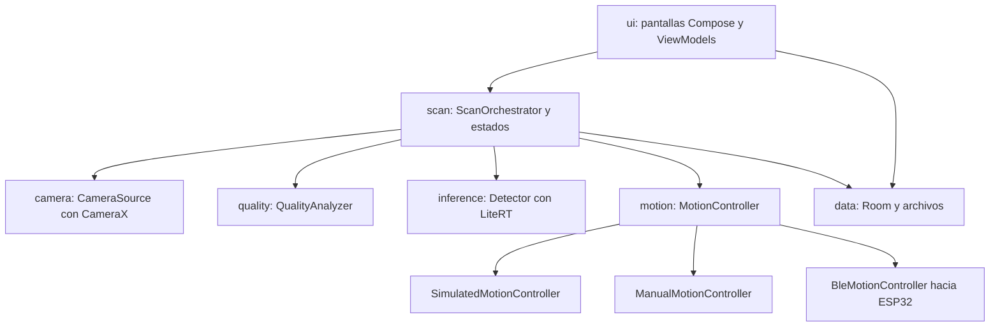
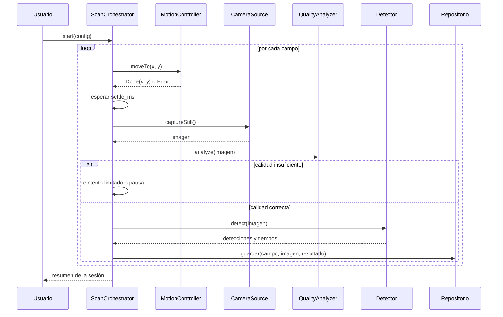
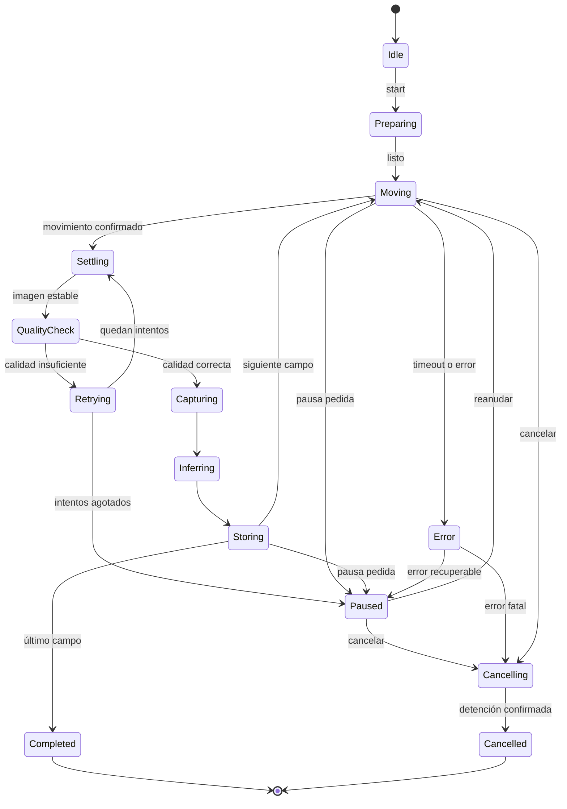

# Especificación del MVP de Mica TB

Documento de referencia para el desarrollo con Claude Code. Las cifras marcadas "a calibrar" son valores iniciales que se ajustan midiendo en el hardware real. Nada de esto es una validación clínica.

## 1. Alcance

Objetivo del MVP: con el celular sobre el ocular, capturar campos microscópicos, ejecutar el modelo TFLite offline, mostrar cajas y conteo por campo, consolidar los resultados de una sesión y guardarlos para revisión. El barrido motorizado se construye detrás de una interfaz con simulador.

Prioridad: la rebanada cámara, IA y resultado (Fase 1) es lo que debe funcionar primero y funcionar bien.

## 2. Requisitos

Clasificación: MUST es del MVP, SHOULD entra si hay tiempo, LATER se pospone.

| ID | Requisito | Prioridad | Fase | Verificación |
|---|---|---|---|---|
| RF01 | Vista previa de la cámara | MUST | 1 | prueba en celular |
| RF02 | Capturar foto en resolución alta y revisarla | MUST | 1 | 20 capturas seguidas sin fallo |
| RF03 | Cargar y ejecutar el modelo TFLite localmente, configurado por model_config.json | MUST | 1 | prueba de paridad |
| RF04 | Mostrar cajas, clases, puntajes y conteos según el contrato del modelo | MUST | 1 | revisión visual con imágenes de prueba |
| RF16 | Cambiar de modelo solo con model_config.json (sin tocar código) | MUST | 1 | cargar un segundo modelo de prueba |
| RF17 | Umbral conf ajustable sin recapturar ni reejecutar el modelo | MUST | 1 | prueba unitaria y manual |
| RF18 | Guardar la foto original sin cajas más un JSON del resultado | MUST | 1 | revisar archivos |
| RF09 | Evaluar calidad (nitidez, brillo, saturación) y manejar capturas inválidas | MUST | 1 | imágenes borrosas puntúan menos |
| RF19 | Benchmark de latencia en el celular | MUST | 1 | informe generado |
| RF07 | Sesión de varios campos, con movimiento manual primero | MUST | 2 | sesión de 10 campos |
| RF12 | Progreso: campos completados, pendientes y fallidos | MUST | 2 | prueba manual |
| RF13 | Consolidar resultados y revisar imágenes de la sesión | MUST | 2 | prueba manual |
| RF14 | Guardar y consultar sesiones anteriores | MUST | 2 | cerrar y reabrir la app |
| RF15 | Funcionar sin internet (sin permiso INTERNET) | MUST | 1 en adelante | modo avión y revisión del manifiesto |
| RF10 | Registrar foto, coordenadas, resultado y metadatos de cada campo | MUST | 2 | revisar la base |
| RF11 | Pausar, reanudar y cancelar con detención segura | MUST | 3 | pruebas con simulador |
| RF08 | Captura coordinada con movimiento y estabilización | MUST | 3 | barrido simulado |
| RF05 | Comunicación BLE con el microcontrolador | SHOULD (depende de hardware) | 4 | simulador de ESP32 y luego real |
| RF06 | Comandos de movimiento con confirmación | SHOULD (depende de hardware) | 4 | pruebas de timeout y duplicados |
| RF20 | Gradación de demostración por escala OMS configurable | SHOULD | 2 | prueba unitaria con casos conocidos |
| RF21 | Recuperar una sesión interrumpida | SHOULD | 3 | matar la app a mitad de sesión |
| RF22 | Mapa visual de campos examinados | LATER | 6 | |
| RF23 | Exportar reporte PDF | LATER | 6 | |
| RF24 | Deduplicar hallazgos en campos solapados | LATER | 6 | |
| RF25 | Autofoco con eje Z motorizado | LATER | 6 | |
| RF26 | Inferencia por mosaicos a escala nativa | LATER (se decide tras el pase con fotos reales) | 6 | |
| RF27 | Aceleración por GPU | LATER | 6 | conteo igual que en CPU |

Regla de gradación: la tabla de la escala vive en un archivo de configuración y el resultado se rotula "gradación de demostración, no diagnóstica". Antes de presentarla hay que validar la tabla con la persona especializada del equipo.

## 3. Arquitectura



Idea central: ScanOrchestrator no sabe si el movimiento es manual, simulado o por BLE. Eso permite construir y probar todo sin hardware.

### Interfaces principales (Kotlin, indicativas)

```kotlin
interface Detector {
    suspend fun load(config: ModelConfig)
    suspend fun detect(image: Bitmap, baseConf: Float = 0.25f): RawDetections   // sin filtrar por conf final
}
fun filterAndCount(raw: RawDetections, params: PostParams, counting: CountingConfig): DetectionResult

interface QualityAnalyzer { fun analyze(image: Bitmap, cfg: QualityConfig): QualityReport }

interface CameraSource {
    val previewSurface: ...
    suspend fun lockExposureAndWhiteBalance()
    suspend fun captureStill(): CapturedImage     // JPEG a resolución máxima, con EXIF
}

interface MotionController {
    val state: StateFlow<MotionState>
    suspend fun connect()
    suspend fun home()
    suspend fun moveTo(x: Int, y: Int): MoveResult   // espera confirmación real
    suspend fun stop()                               // inmediato
}

class ScanOrchestrator(camera, quality, detector, motion, repo, config) {
    val state: StateFlow<ScanState>
    fun start(); fun pause(); fun resume(); fun cancel()
}

fun generateSnakePath(cols: Int, rows: Int, stepX: Int, stepY: Int, origin: Point): List<FieldPos>
```

Implementaciones de MotionController: SimulatedMotionController (retardos y fallos configurables), ManualMotionController (la app pide "mueve la lámina a la posición N y pulsa continuar") y BleMotionController.

### Concurrencia

- Un solo flujo secuencial por campo en el orquestador (corrutina). No se paraleliza la captura con el movimiento: la imagen debe estar estable.
- La inferencia y el guardado corren en Dispatchers.Default o IO. La interfaz solo observa StateFlow.
- Una imagen a la vez en memoria. Reciclar bitmaps. Las miniaturas para la galería se generan aparte.

## 4. Flujo de captura de un campo



### Máquina de estados del barrido



Reglas: pausar surte efecto al terminar el paso atómico en curso (captura, inferencia o guardado) y antes de iniciar el siguiente movimiento. Cancelar envía STOP de inmediato. Un campo con calidad no válida no cuenta como examinado.

### Control de calidad (valores iniciales, a calibrar)

- Nitidez: varianza del Laplaciano sobre la imagen en gris reducida. Umbral en configuración. Hace falta una pantalla de calibración: capturar N fotos enfocadas y N desenfocadas, mostrar los puntajes y sugerir el umbral.
- Brillo: media de gris dentro de un rango. Saturación: fracción de píxeles recortados menor que un máximo.
- Estabilización: espera fija settle_ms (valor inicial 800 ms, a calibrar) y, como mejora, comparar dos vistas previas consecutivas.
- Reintentos: máximo 2 por campo. Si fallan, política configurable: pausar (por defecto) u omitir y marcar el campo.
- Cámara: bloquear exposición, balance de blancos y enfoque antes de la sesión para que no cambien entre campos. Tocar para enfocar antes de bloquear.

## 5. Protocolo BLE con el ESP32 (propuesta a acordar con el firmware)

- Un servicio GATT con dos características: CMD (la app escribe) y EVT (el controlador notifica). El UUID se define junto al firmware. Solicitar MTU alto y mantener las tramas cortas.
- Tramas ASCII terminadas en salto de línea, máximo 64 bytes: id VERBO argumentos.
- Comandos: HELLO, HOME, MOVE_ABS x y (en pasos, enteros), STOP, STATUS, PING.
- Eventos: HELLO_OK (versión, límites, estado), ACK id, DONE id x y, ERR id código, STATE estado, PONG.
- Estados del controlador: BOOT, UNHOMED, HOMING, IDLE, MOVING, STOPPED, FAULT. No se acepta MOVE_ABS sin homing.
- Códigos de error: LIMIT, BUSY, UNHOMED, BAD_ARG, FAULT.
- id es un entero creciente de 16 bits. Si el firmware recibe un id repetido, reenvía el ACK o el DONE sin volver a ejecutar. MOVE_ABS es idempotente (posición absoluta), así que reintentar es seguro.
- Timeouts iniciales (a calibrar): ACK 500 ms con hasta 3 reintentos con el mismo id. DONE: tiempo estimado por distancia y velocidad, por 2, más 2 s.
- Vigilancia: la app envía PING cada 1 s durante un barrido. Si el firmware no recibe PING en 3 s, se detiene. Si BLE se desconecta, se detiene.
- Tras reconectar: STATUS y comparar la posición con el último DONE confirmado. Si no coincide, exigir HOME.
- STOP se atiende con prioridad sobre cualquier otro comando y responde con STATE STOPPED.
- El firmware aplica límites suaves y finales de carrera por su cuenta. La app también valida límites antes de enviar.
- Para desarrollar sin hardware: un simulador de ESP32 que habla este mismo protocolo (clase de prueba en la app o script aparte) y permite inyectar pérdida de ACK, DONE tardío, duplicados y desconexión.

## 6. Pantallas (MVP)

Navegación: Navigation Compose con 5 destinos.

1. Inicio: nueva sesión, historial, estado del modelo.
2. Captura y análisis (la pantalla central de la Fase 1): vista previa, botón de captura, cajas y conteos, deslizador de conf, interruptor de conteo estricto o amplio, tiempos, indicador de calidad.
3. Sesión: progreso, lista de campos con su estado, controles de iniciar, pausar, reanudar y cancelar, modo de movimiento (manual, simulado o BLE). Aquí se fusionan Preparación y Configuración como un panel inicial.
4. Resultados: resumen (campos válidos, conteo total, promedio por campo, gradación de demostración), galería con superposición de cajas y acceso a la foto original.
5. Ajustes técnicos: información del modelo (id, hash, clases), umbrales, calibración de nitidez, benchmark, estado de BLE.

Reglas de interfaz: aviso visible "apoyo al tamizaje, no diagnóstico" y, mientras el modelo sea el de E. coli, "modelo de demostración con E. coli". Estados de carga y errores comprensibles. Controles grandes y legibles en un ambiente de laboratorio con poca luz.

## 7. Modelo de datos (Room sobre SQLite)

```text
sessions(id TEXT PK, created_at INT, finished_at INT NULL,
         status TEXT,            -- CREATED, RUNNING, PAUSED, COMPLETED, CANCELLED, FAILED
         sample_label TEXT NULL, -- texto libre, sin datos de paciente
         model_id TEXT, model_sha256 TEXT,
         config_json TEXT,       -- barrido, umbrales, calidad, modo de movimiento
         notes TEXT NULL)

fields(id INT PK AUTOINCREMENT, session_id TEXT FK, idx INT, x INT, y INT,
       status TEXT,              -- PENDING, VALID, INVALID_QUALITY, FAILED_MOTION, FAILED_OTHER, SKIPPED
       attempts INT, quality_json TEXT, UNIQUE(session_id, idx))

captures(id INT PK, field_id INT FK, path TEXT, width INT, height INT,
         sha256 TEXT, captured_at INT, attempt INT)

inferences(id INT PK, capture_id INT FK, model_id TEXT, base_conf REAL,
           conf REAL, nms_iou REAL, count_strict INT, count_broad INT,
           detections_json TEXT,   -- detecciones crudas con puntaje, para refiltrar
           t_pre_ms REAL, t_infer_ms REAL, t_post_ms REAL, created_at INT)
```

Integridad: escribir primero el archivo de la foto (temporal y luego renombrar) y después la fila en una transacción. Guardar el estado de la sesión tras cada campo. Al iniciar, reconciliar archivos huérfanos. La sesión debe poder reconstruir el reporte solo con estas tablas y los archivos.

## 8. Requisitos no funcionales (objetivos iniciales, a calibrar)

| Tema | Objetivo inicial | Cómo validarlo |
|---|---|---|
| Latencia de inferencia | mediana menor que 150 ms | benchmark en el celular, sección 7 del contrato |
| Captura y guardado por campo | menor que 2 s sin contar el movimiento | cronometrar en el registro |
| Memoria | sesión de 100 campos sin cierre por memoria insuficiente | prueba larga con el simulador |
| Estabilidad de cámara | 20 capturas seguidas sin error y exposición constante | prueba manual y registro de metadatos EXIF |
| Compatibilidad | Android 8 en adelante, probar en el celular real | prueba en dispositivo |
| BLE | tasa de comandos perdidos tolerada por reintentos, sin movimientos duplicados | simulador con fallos inyectados |
| Offline | sin permiso INTERNET, funciona en modo avión | revisar manifiesto y probar |
| Integridad | sin fotos faltantes ni duplicadas en una sesión | consulta de verificación |
| Privacidad | sin datos de pacientes, almacenamiento privado de la app | revisión |
| Térmico | latencia estable tras 5 minutos de uso continuo | benchmark repetido |
| Pruebas | lógica pura con pruebas JVM, modelo con prueba instrumentada | gradlew test y connectedDebugAndroidTest |

Distinción importante: estas son pruebas funcionales de software. La validación clínica del sistema es un trabajo aparte con muestras reales y personal especializado.

## 9. Fases, compuertas y esfuerzo

Los esfuerzos son estimados en días de trabajo con asistencia de un agente. Son aproximados y dependen de la experiencia con Android y del acceso al celular.

Fase 0, preparación y contrato (0,5 a 1 día)
- Objetivo: saber exactamente qué hace el modelo y tener el proyecto base.
- Entregables: model_config.json verificado, reference_infer.py, test_vectors, proyecto Android que abre en el celular, comandos en CLAUDE.md.
- Compuerta: el script de Python reproduce los resultados esperados con el .tflite y el celular aparece con adb devices.
- Riesgo: que falten los vectores de prueba. Se generan en MT-01.

Fase 1, cámara e IA (3 a 4 días) 
- Objetivo: capturar con la cámara, detectar, mostrar y guardar. Es el corazón de la app.
- Compuertas:
  1. Paridad con Python (sección 6 del contrato).
  2. Latencia medida en el celular y registrada.
  3. 20 capturas seguidas con exposición y balance de blancos bloqueados, rotación EXIF correcta, sin cierres.
  4. Las imágenes desenfocadas puntúan menos que sus originales en nitidez.
  5. Prueba de extremo a extremo en el celular: foto, calidad, detección, cajas, conteo y archivos guardados. Apuntar a una pantalla con una imagen de prueba sirve solo como prueba de humo, por el efecto de la trama de la pantalla.
- Riesgos: interpretación errónea del tensor de salida, rotación EXIF, enfoque automático oscilando, diferencias entre fabricantes de cámaras.

Fase 2, sesión de varios campos, resultados e historial (2 a 3 días)
- Objetivo: una app usable sin hardware motorizado, con movimiento manual.
- Entregables: Room, sesión con ManualMotionController, resultados consolidados, historial, gradación de demostración.
- Compuerta: sesión de 10 campos, cerrar y reabrir la app, ver resultados y fotos intactos.

Fase 3, barrido automatizado con simulador (2 a 3 días)
- Objetivo: orquestador completo con máquina de estados, serpentino, pausa, reanudación y cancelación.
- Compuerta: pruebas JVM del serpentino y de los estados, barrido simulado con fallos inyectados, recuperación de una sesión interrumpida.

Fase 4, BLE y ESP32 real (3 a 5 días, depende del firmware)
- Objetivo: BleMotionController con el protocolo de la sección 5 y simulador de ESP32.
- Compuerta: movimientos confirmados, reintentos sin duplicar, desconexión segura, STOP inmediato.
- Riesgo: el firmware no está listo. Se avanza con el simulador y se integra después.

Fase 5, integración y validación (2 a 4 días)
- Objetivo: celular montado en el microscopio real, calibración de campo de visión, solapamiento, tiempo de estabilización y umbral de nitidez, APK de demostración y lista de verificación offline.
- Compuerta: barrido físico completo sin fotos faltantes ni duplicadas y plan B con imágenes fijas.

Fase 6, mejoras posteriores
- Modelo de TB, inferencia por mosaicos, deduplicación en campos solapados, PDF, mapa de campos, GPU, autofoco motorizado.

Línea de corte sugerida para la demo: Fases 0, 1 y 2 son indispensables. La Fase 3 conviene. La 4 depende del hardware.

## 10. Riesgos y mitigaciones

| Riesgo | Mitigación |
|---|---|
| Salida del modelo mal interpretada | inspección de tensores y paridad con Python antes de construir la interfaz |
| Brecha de dominio (fotos del celular contra imágenes de entrenamiento) | pase cualitativo con 20 a 30 campos reales, conf ajustable, guardar originales para la fase de capturas propias |
| Enfoque automático oscilando sobre la imagen del microscopio | bloquear enfoque tras tocar para enfocar, enfoque manual inicial |
| Exposición y color cambiando entre campos | bloqueo de exposición y balance de blancos |
| Rotación EXIF incorrecta | prueba con cajas alineadas sobre imágenes de orientación conocida |
| Estrangulamiento térmico en sesiones largas | benchmark térmico, evitar trabajo innecesario, GPU como opción |
| Pérdida o duplicado de comandos BLE | ids, idempotencia, ACK, simulador con fallos inyectados |
| Movimiento físico inseguro | límites en firmware y en la app, vigilancia, STOP prioritario |
| Conteos duplicados en campos solapados | en el MVP, solapamiento cero o bajo y conteo por campo; deduplicar en la Fase 6 |
| Confundir el modelo de E. coli con uno de TB | rótulo visible, domain_note en la configuración, nada de lenguaje clínico |
| Degradación en INT8 | usar FP16 como predeterminado, INT8 solo como opción medida |

## 11. Decisiones pendientes

Bloqueantes (se resuelven antes o durante la Fase 0):
- Salida real del modelo y orden de clases: MT-01.
- Modelo y versión de Android del celular de pruebas: se pide al equipo.

Configurables (valores en archivo de configuración, se calibran):
- Campo de visión y solapamiento, paso entre campos, tiempo de estabilización, umbrales de nitidez y brillo, cantidad de campos por protocolo, tiempos de BLE.

Postergables:
- Motores y controladores exactos, finales de carrera, ESP32 confirmado, estrategia exacta de posicionamiento, adaptador óptico definitivo, disponibilidad de muestras reales.

## 12. Primer sprint (primer prototipo funcional)

1. Fase 0: inspeccionar el .tflite, completar model_config.json, generar reference_infer.py y los vectores de prueba.
2. Crear el proyecto Android (Compose, sin permiso INTERNET) y correrlo en el celular.
3. Implementar y probar en JVM: letterbox, decodificación, NMS y conteo (MT-03, MT-04).
4. Pasar la prueba de paridad en el celular (MT-04).
5. Pantalla de imagen fija con cajas y conteo (MT-05).
6. CameraX con captura y bloqueos (MT-06), calidad (MT-07) y pantalla integrada (MT-08).
7. Benchmark (MT-09). Aquí ya existe el primer prototipo que usa la cámara con la IA.
